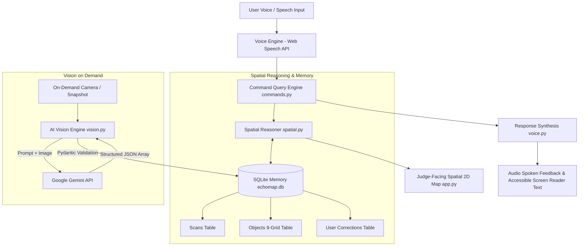

# 🗺️ EchoMap: Your World, Remembered.

**AI-Powered Persistent Spatial Memory Assistant for Blind and Low-Vision Individuals**  
*Built by Team PythonCharlie for the University of Bedfordshire HCI + AI + XR Hackathon*

[](https://www.python.org/)
[](https://aistudio.google.com/)
[](https://www.sqlite.org/)
[](https://streamlit.io/)
[](https://opensource.org/licenses/MIT)

---

## 🎯 The Vision & Problem Statement

Blind and low-vision individuals often experience disorientation when everyday items on a desk, kitchen counter, or workspace are moved, bumped, or misplaced. Existing computer vision solutions are either:
1. **Intrusive & Costly:** Continuously streaming video to heavy models drains battery and raises severe privacy concerns.
2. **Ephemeral:** They identify what is in front of the lens right now, but have **zero memory** of where things were five minutes or three days ago.

### **The EchoMap Solution**
EchoMap bridges this gap through **User-Controlled, Persistent Spatial Memory**:
- **Camera OFF by default:** Scans occur only when the user explicitly triggers one.
- **Persistent Spatial Awareness:** Stores object names, normalized (x, y) coordinates, 9-grid sectors, and relative spatial relationships in SQLite.
- **Offline Querying:** Answers "Where are my keys?" or "What's beside my phone?" straight from saved memory without turning on the camera or consuming AI quota.
- **Intelligent Movement Diffing:** Compares new scans against historical scans to confirm if an item is stationary, moved, missing, or newly introduced.
- **Human-in-the-Loop Learning:** Allows users to teach tactile corrections (e.g., *"My keys are in the leather tray beside my phone"*), keeping user facts distinct from camera detections.

---

## 🎙️ Natural User Experience (Demo Script)

> **User:** *"Hey EchoMap, where are my keys?"*  
> **EchoMap:** *"Your keys were in the centre of the desk, just to the left of your phone in the 14:30 scan. Would you like me to check their current position?"*  
> **User:** *"Yes, check."*  
> **EchoMap:** *(Scans desk)* *"I've scanned your desk. Your keys appear to have moved to the bottom-right area near your notebook."*

---

## 🏗️ System Architecture



---

## 📂 Repository Structure

```
EchoMap/
├── app.py                 # Streamlit UI, visual spatial map, and dashboard
├── vision.py              # Google Gemini API vision engine & Pydantic schemas
├── memory.py              # SQLite persistent spatial memory & corrections
├── spatial.py             # 9-grid geometry, distance, and scan diffing
├── commands.py            # Natural language query engine
├── voice.py               # Browser speech synthesis (TTS) & Web Speech mic widget
├── requirements.txt       # Python dependencies
├── .env.example           # Configuration template
├── .gitignore             # Standard Python / SQLite gitignore
├── README.md              # Project documentation
└── tests/                 # Pytest test suite
    ├── test_spatial.py    # Spatial reasoning & movement verification tests
    ├── test_memory.py     # SQLite persistence & correction tests
    └── test_commands.py   # Query processing tests
```

---

## 🚀 Quick Start Guide

### 1. Clone & Set Up Virtual Environment

```powershell
# In PowerShell (Windows)
git clone https://github.com/PythonCharlie/EchoMap.git
cd EchoMap

python -m venv .venv
.\.venv\Scripts\Activate.ps1
python -m pip install --upgrade pip
pip install -r requirements.txt
```

### 2. Configure Your API Key

1. Get a free Gemini API key from [Google AI Studio](https://aistudio.google.com/).
2. Copy `.env.example` to `.env`:
```powershell
Copy-Item .env.example .env
```
3. Open `.env` and paste your key:
```ini
GEMINI_API_KEY=AIzaSy...
GEMINI_MODEL=gemini-2.5-flash
```

*(Note: If you run EchoMap without an API key, the built-in **Demo/Mock Mode** will automatically activate so you can evaluate all spatial reasoning, voice, and memory features offline!)*

### 3. Run Automated Tests

```powershell
pytest -v
```

### 4. Launch EchoMap

```powershell
streamlit run app.py
```

Your browser will automatically open at `http://localhost:8501`.

---

## 🛡️ HCI, Accessibility, & Ethical Design

- **Camera Autonomy:** Video cameras can feel invasive for disabled individuals and their families. EchoMap never runs background video streaming; image processing is strictly user-invoked.
- **High-Contrast & Screen-Reader Readiness:** The UI is designed with high-contrast colorways, ARIA live-regions (`aria-live="polite"`), and clear keyboard navigation.
- **Distinguishing Uncertainty:** Missing objects are classified as `not_detected` rather than declaring an item lost or permanently moved, preventing false confidence.
- **Separation of Concerns:** Algorithmic camera estimates and user-taught relationships are tracked in distinct database tables.

---

## 👥 Team PythonCharlie

- **Institution:** University of Bedfordshire
- **Event:** HCI + AI + XR Hackathon
- **Team Lead:** Bijon
- **Core Focus:** AI-powered Assistive Technology & Spatial Perception

---

*EchoMap — Your World, Remembered.* 🗺️✨
